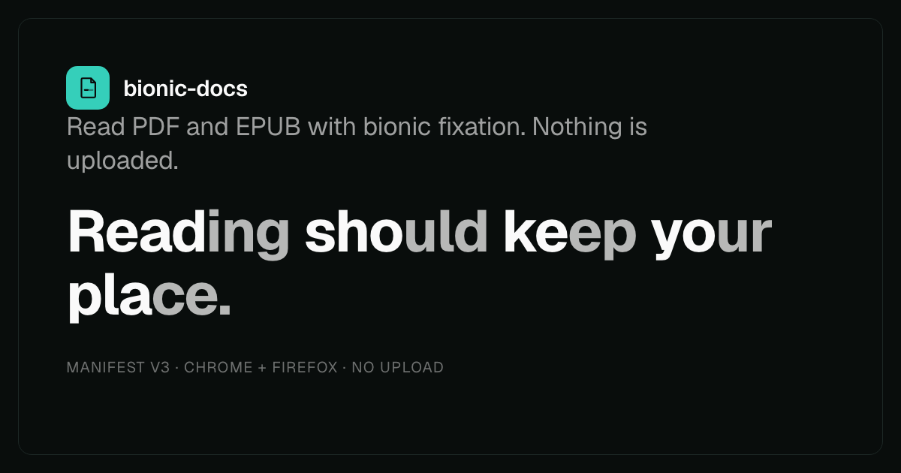

<div align="center">

# Bionic Docs

**Read PDF and EPUB with bionic fixation, entirely on-device.**

A Manifest V3 extension for Chrome, Edge and Firefox. Every PDF page stays as it
was printed, the leading letters of each word carry the weight, and nothing is
uploaded.

[](https://github.com/srivtx/bionic-docs/actions/workflows/ci.yml)
[](https://github.com/srivtx/bionic-docs/releases)
[](LICENSE)
[](https://bun.sh)
[](tsconfig.json)
[](scripts/manifest.mjs)
[](#testing)
[](#testing)
[](#privacy)
[](https://www.mozilla.org/firefox/)
[](https://www.google.com/chrome/)

**[Website and live demo](https://srivtx.github.io/bionic-docs)** · [Features](#features) · [Install](#install) · [Usage](#usage) ·
[Privacy](#privacy) · [Architecture](#architecture) · [Testing](#testing) · [Limitations](#limitations) · [Family](#family)



</div>

---

## Why this exists

The bionic-reading extensions that handle documents send your files to a
server, and the local ones do not handle documents. Nothing combined
**on-device**, **no account**, **PDF and EPUB**, and **Chrome and Firefox** in
one Manifest V3 build. [`docs/PRIOR-ART.md`](docs/PRIOR-ART.md) records the
verified comparison: the 100K-user incumbent posts page text to its own API,
and the only store product that does files is cloud-based, paid and
Chromium-only.

## Features

- **Pages as they were printed.** A bundled PDF.js draws each page to a
  canvas, so images, diagrams, colours and layout stay. The text is laid back
  over the page at the same position and width, then emphasized.
- **Fit and zoom.** Pages open fitted to the window. A zoom bar steps from 50%
  to 300% or switches between Fit page and Fit width, and keeps your place on
  the page.
- **EPUB, reflowed.** Books are unzipped in memory and their chapters
  sanitized and reflowed. The book's own table of contents becomes the
  Contents panel.
- **Five reading modes.** Half, Classic, Vowel anchor, Low distraction and a
  Custom rule, with an intensity control that works in every mode. The
  algorithm is shared with [Bionic Page](https://github.com/srivtx/bionic-page).
- **Contents and resume.** A collapsible page or chapter list. Reopen a
  document and the reader offers your last position; it remembers 25
  documents, on this device only.
- **Keyboard first.** Every reader action has a key (see [Usage](#usage)). The
  mode and zoom menus are drawn by the extension and work with arrows, Enter,
  Escape and type-ahead.
- **No server.** No upload, no analytics, no account and no remote code.

## Install

Store listings are pending. To build from source you need [Bun](https://bun.sh):

```bash
git clone https://github.com/srivtx/bionic-docs
cd bionic-docs
bun install
bun run build
```

- **Chrome / Edge:** open `chrome://extensions`, turn on Developer mode,
  choose Load unpacked and pick `dist/chrome`.
- **Firefox 140+:** open `about:debugging`, choose This Firefox, then Load
  Temporary Add-on, and pick `dist/firefox/manifest.json`.

## Usage

1. Click the toolbar icon and choose **Open current document** for a PDF open
   in a tab, or **Open a file…**. You can also drop a file onto the reader.
2. Pick a mode and set the intensity in the reader's toolbar. Changes apply
   live.
3. PDF pages open fitted to the window. Use the zoom bar at the bottom to
   change the size.
4. Reopen a document and the reader offers to resume where you left off.

| Key | Action |
|---|---|
| `←` `→` or `PageUp` `PageDown` | Previous or next page (PDF) or chapter (EPUB) |
| `Home` `End` | First or last |
| `+` `−` | Zoom in or out (PDF) |
| `0` | Fit page (PDF) |
| `C` | Show or hide Contents |
| `Ctrl`/`Cmd`+`Shift`+`O` | Open the current document from any tab |

Local `file://` PDFs open in place once file access is allowed for the
extension in the browser's extension settings.

## Privacy

Bionic Docs makes **no network requests** for content. The only `fetch` in the
codebase loads the document you explicitly opened. Files are parsed in the
extension page, and nothing leaves the device. PDF.js, its worker, cmaps and
standard fonts are bundled into the package. A security test fails the build
if `fetch`, `eval`, `new Function`, `document.write`, remote URLs,
`XMLHttpRequest` or `WebSocket` appear anywhere else in `src/`. See
[`SECURITY.md`](SECURITY.md) for the threat model.

## Architecture

```
popup / background ──(open)──▶ reader.html?src=…
reader/reader.ts      sniffs the first bytes, owns toolbar, zoom, contents, resume
  ├── pdf/pdf.ts      PDF.js canvas page + positioned text layer → fixation
  │     layout.ts     text-item geometry and colour matching (pure, tested)
  │     zoom.ts       fit and zoom maths (pure, tested)
  ├── epub/epub.ts    fflate unzip → OPF, spine, contents → sanitized chapters → fixation
  ├── shared/select.ts designed menus over native <select>s
  └── core/*          pure fixation algorithm, shared with Bionic Page
```

[`docs/ARCHITECTURE.md`](docs/ARCHITECTURE.md) has the invariants and
[`docs/CONTRACTS.md`](docs/CONTRACTS.md) the exact module interfaces.

## Development

```bash
bun install
bun run typecheck     # strict TypeScript, noUnusedLocals
bun test              # unit and fixture tests
bun run make-fixtures # regenerate fixtures/sample.pdf and sample.epub
bun run build         # dist/chrome and dist/firefox
bun run verify        # every manifest-referenced file exists
bun run e2e           # real Chrome: opens the PDF and EPUB fixtures
bun run site          # rebuild the site's core.js, OG card and asset stamps, then check
bun run e2e:site      # load the website in Chrome and drive its demo
bun run package       # zip both targets
bun run lint:firefox  # web-ext lint
```

The website in `site/` is plain HTML, CSS and JavaScript with no build step and
no external requests. Its demo runs `site/assets/core.js`, which
`scripts/build-demo.mjs` compiles from `src/core/`, so the site and the
extension render the same emphasis.

## Testing

| Gate | Result |
|---|---|
| `bun test` | 160 tests across 8 files |
| `bunx tsc --noEmit` | clean (strict TypeScript) |
| build + verify | both targets, 11 referenced entries present each |
| `web-ext lint` | 0 errors (4 warnings from vendored PDF.js) |
| `bun run e2e` | 23/23 in real Chrome: PDF pages, diagram, colours, zoom and menus, EPUB, fixation and navigation |
| `bun run e2e:site` | the website loads without errors and its demo, divider and theme work |

The extension e2e serves the built pages and the generated fixtures and drives
real Chrome over the DevTools protocol. It checks that PDF text sits where the
page drew it, that the diagram and colours survive, that zoom and the menus
work, and that an EPUB renders, exposes its title and advances chapters.

## Limitations

- **Scanned PDFs** have no text layer, so the page is shown as an image
  without emphasis. OCR is out of scope for now.
- Emphasized PDF text is drawn in the browser's own fonts, stretched to each
  line's original width, so letter shapes can differ from the document's
  embedded fonts. Text that PDF.js paints inside transparency groups or as
  Type 3 glyphs keeps its original look and does not get the emphasis.
- EPUB rendering is intentionally minimal: no pagination, and no book CSS
  beyond the sanitized chapter markup.
- The Firefox floor is 140 because `data_collection_permissions` is only
  understood from that version.

## Family

| | Reads | Website |
|---|---|---|
| **Bionic Docs** (this repo) | PDF and EPUB files, with every PDF page kept as printed | [srivtx.github.io/bionic-docs](https://srivtx.github.io/bionic-docs) |
| **[Bionic Page](https://github.com/srivtx/bionic-page)** | Any web page, in place | [srivtx.github.io/bionic-page](https://srivtx.github.io/bionic-page) |

Both share the fixation algorithm in `src/core/`, run entirely on-device, and
build for Chrome and Firefox from one source tree.

## License

[MIT](LICENSE). Not affiliated with Bionic Reading GmbH.
